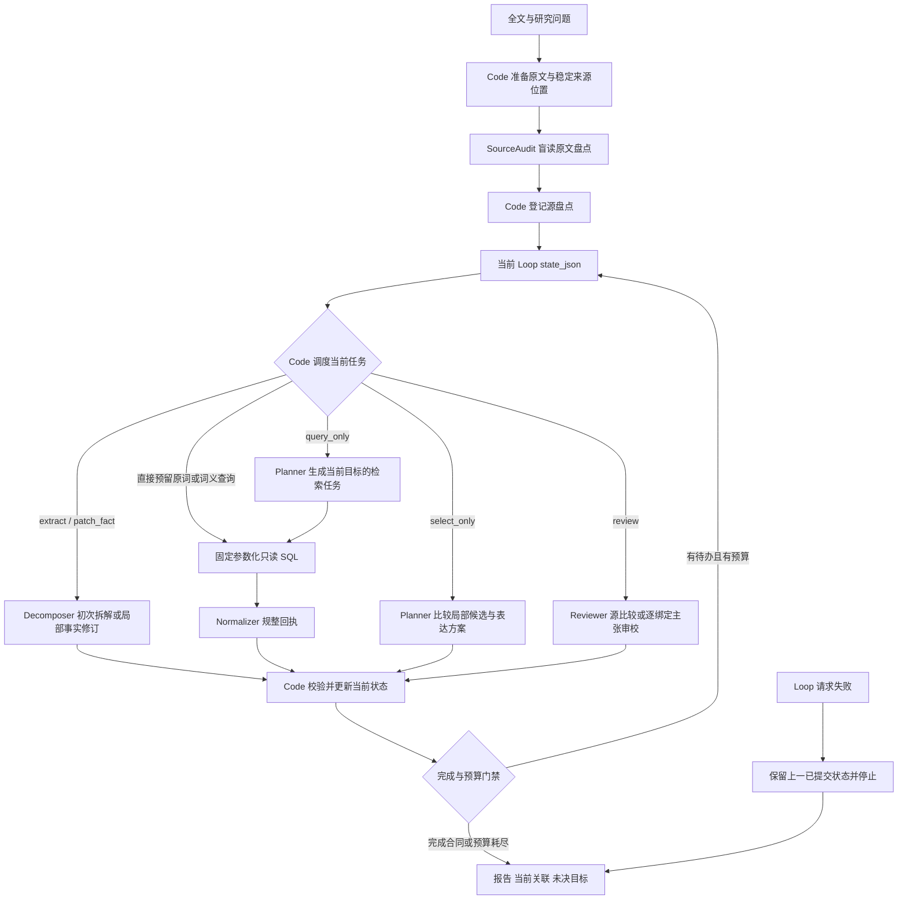

# 工作流机制与运行合同

本文描述 E91 归档实现；证据截至 2026-10-25。公开归档没有新增服务、数据库或模型实验。节点、插件与绑定的精确配置以 [`../dify/configuration_summary.json`](../dify/configuration_summary.json)、[`../dify/node_entrypoints.json`](../dify/node_entrypoints.json) 和实际导出衍生 DSL 为准。

## 控制流

这是职责图，不是 30 节点的逐线部署图。`query_only`、`select_only`、`review` 是分别派发的任务，不要求每一轮按固定顺序执行。事实抽取或表达选择后可以在同一波进入审校。每条路径均须把更新后的状态写回 Loop，下一轮不能重新使用准备节点的初始状态。

## 角色与交接

| 组件 | 输入与职责 | 交接产物 |
|---|---|---|
| 准备 Code | 保留全文，建立稳定来源位置及初始状态 | 固定来源、策略合同、状态 |
| SourceAudit | Loop 之前独立读原文，不接收拆解或编码答案 | 源断言盘点，供后续查漏比较 |
| Code 调度 | 读取当前事实、查询回执、绑定修订、待办目标和剩余预算 | 一次受约束任务 |
| Decomposer | 首次拆解，或对指定源缺口做局部事实修订 | 带主体、断言、时间、数值及限定附着的事实 |
| Planner | 在已派发任务内选择查询词，或比较单一概念与核心加限定的表达 | 查询提案或局部绑定提案 |
| SQL 与 Normalizer | 固定只读查询及回执规整 | 候选、元数据、检索到的词义及关系证据 |
| Reviewer | `source_compare`、`source_delta`、`mapping_verify`、`mapping_delta` 不同职责的调用 | 当前版本的具型审校结果及证据引用 |
| 更新 Code | 核验回执、目标、来源、修订、重复拒案和覆盖合同 | 当前状态、逐目标账本、待办与停止原因 |

Code 校验结构、作用域与来源一致性，不独立判定医学真伪。Reviewer 是另一次模型调用；相同模型自审不是独立专家金标准。盲源盘点也只是独立参照，不保证抽取完整。

## 词表与语义证据

查询使用部署者已有的 PostgreSQL OHDSI 词表。候选字段包括 `concept_id`、名称、词汇表、域、概念类别、标准状态及有效性；同义词和有向关系仅在实际检索到时进入证据包。候选必须与本次目标、请求和批次对应，不能把整池候选当作某个绑定已经获得证据。

Planner 的提议关系、模型支持意见与 Code 接受的证据强度分别保存。标签关联不等于严格等价；名称相似不自动证明宽窄、解剖附着或复合诊断含义。研究设置的严格等价门禁是一项主张政策，不是 OHDSI 对所有使用场景的统一规则。本原型不证明 OMOP 表级映射、标准后协调表达或正式表级落库已经完成。

## 反馈与逐目标关闭

问题键综合来源、目标、修订、规范化谓词、动作及绑定语义身份。引文窗口、说明措辞或重复时间戳变化不应制造新缺口；真正的新证据代次另外记录。队列区分 `pending`、`submitted`、`rejected` 与 `omitted`，仅派未完成目标。

提交账本不能单独证明关闭。真实关闭应结合当前绑定、`mapping_checks`、问题状态与 `completion_gate` 判断。发现漏项不等于已写回事实；返修只提交部分目标不等于整组修复；格式恢复、关系降级、未触发和 defer 都需分别计数。

## 有限预算与失败

- 最多 **6 个 Loop 波次**。
- search 与 meaning 共用最多 **3 批**预算。
- 最多 **2 个源事实修订波次**。
- 默认每批最多 **6 词**。runtime 的可选策略上限 8、SQL typed search 上限 6、legacy array 上限 8 的合同差异仍存在。
- 规则 JSON 提取及有限合同恢复受总预算约束，不能把每次不合规回答变成无限模型重试。

Loop 请求失败时保留上一已提交状态并停止，不自动重复外部请求。源盘点及 staging 的前置错误分支可保留已准备来源；准备节点自身没有统一的显式失败保存路径。因此不能声称所有无效输入都能生成完整失败报告。

完成合同的状态是内部工程状态，仍需离线独立核查，不能译成临床成功。

## 策略更新的实际范围

当前实现能在一次运行内依据真实查询和审校反馈改变后续目标，执行补检索、局部重选、事实修订与再审校。`prepare()` 校验 `max_terms`、`action_priority`、`focus_fields`，但只有 `max_terms` 实际影响准备预算；后两者未被保存并用于全局调度。候选 `policy_candidate` 的失败类型与下一动作列表只是输出，没有自动晋升、自动重导入、跨病例共享状态或参数训练。

因此应称为**有限反馈控制与试验性策略候选**，不能称为已验证的跨病例自进化。
